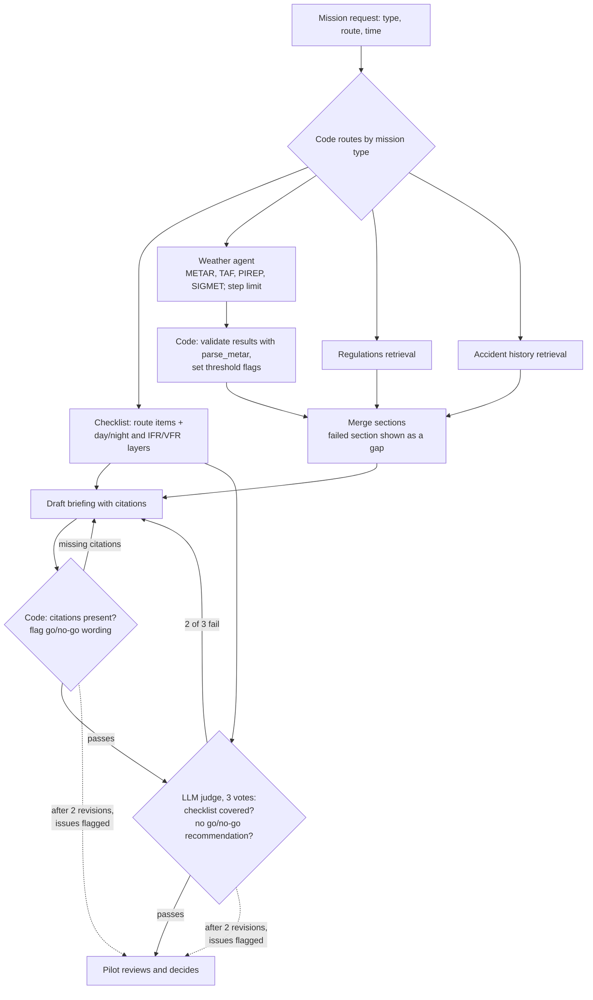

# haa-safety-copilot

"""Unit conversions used in flight planning."""

SM_TO_NM = 0.868976

def statute_to_nautical_miles(statute_miles: float) -> float:
    """Convert statute miles to nautical miles."""
    return statute_miles * SM_TO_NM

## Architecture (Phase 1 sketch)

An agent inside a fixed workflow. Code routes on the mission type the
pilot enters, which selects a checklist. The three research sections run
in parallel; a section that fails appears in the briefing as a visible gap.
The weather section is the only agent: it chooses which stations and
products to check, within a step limit, and code validates every result
and sets hazard flags from fixed thresholds. The draft passes code checks
for citations, which also flag go/no-go wording, then an LLM judge that
votes three times on checklist coverage and on whether the briefing
recommends go or no-go. Revisions are capped at two; a draft that still
fails reaches the pilot with its issues flagged. The pilot in command
makes every go/no-go decision.